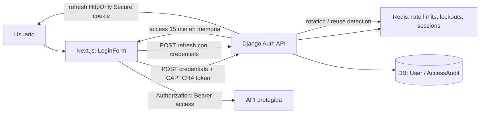

# Plan de hardening de autenticación

**Estado:** implementado en rama de trabajo; pendiente de configuración y validación en staging.

**Ámbito:** `frontend` (Next.js) y `backend2` (Django/DRF)
**Propósito:** cerrar los riesgos detectados en `/auth/login` sin ampliar el
trabajo a un rediseño general de IAM.

## 1. Alcance y límites

Este plan cubre únicamente:

- prevención de envíos concurrentes en la UI de login;
- rate limiting, protección contra fuerza bruta y CAPTCHA adaptativo;
- bloqueo temporal, alertas y auditoría de intentos de login;
- sesiones JWT de corta duración, refresh-token rotation y cierre de sesión;
- migración gradual desde `localStorage` hacia cookies `HttpOnly`;
- pruebas, métricas y procedimiento de despliegue.

Quedan fuera de este cambio: MFA, OAuth/OIDC, SSO, ABAC, cifrado de todos los
campos de negocio, revisión completa de headers de toda la plataforma,
Kubernetes y certificaciones regulatorias. Esos temas pueden reutilizar los
componentes resultantes, pero requieren RFCs independientes.

## 2. Riesgo actual y objetivo

El login actual permite solicitudes concurrentes y guarda access/refresh JWT
en `localStorage`. El access token tiene una vida excesiva. Además, no existe
un control distribuido de intentos por IP o cuenta.

El resultado objetivo es:

1. Una interacción de login produce como máximo una solicitud activa.
2. La API limita abuso por IP y por cuenta aun con varias réplicas.
3. Un access token dura 15 minutos y no se persiste en el navegador.
4. Un refresh token se conserva exclusivamente en cookie `HttpOnly`, rota en
   cada uso y su reuso invalida la familia de sesión.
5. El backend es el único responsable de autorizar, bloquear, revocar y
   auditar una sesión.

## 3. Arquitectura objetivo



### Decisión de transporte

- **Access token:** JWT de 15 minutos, mantenido solo en memoria del runtime
  del frontend. Se agrega mediante un único cliente HTTP centralizado.
- **Refresh token:** cookie `HttpOnly`, `Secure`, `SameSite=Strict`, con path
  restringido al refresh/logout cuando la topología de dominios lo permita.
- **CSRF:** cookie no `HttpOnly` de doble envío o token emitido por backend,
  validado en refresh, logout y cualquier endpoint autenticado que use cookie.
- **CORS:** orígenes explícitos, `Access-Control-Allow-Credentials: true` y
  ninguna combinación de credenciales con `*`.

Antes de fijar `SameSite=Strict`, se validará que frontend y API se entregan
desde el mismo *site* registrable. Si no es así, se documentará una excepción
`SameSite=None; Secure` acompañada de CSRF estricto.

## 4. Organización de código propuesta

No se deben dispersar reglas de autenticación entre vistas de negocio.

### Backend: `apps/authentication/`

```text
apps/authentication/
  api/
    serializers/
      login.py                 # Validación y contratos HTTP de login
      session.py               # Refresh/logout/CSRF
    views/
      login.py                 # Adaptador HTTP, sin lógica de seguridad
      session.py
  services/
    login_service.py           # Orquestación de login y respuestas genéricas
    token_service.py           # Emisión, claims, rotación y revocación
    throttle_service.py        # Redis: IP, cuenta, backoff y TTL
    captcha_service.py         # Verificación server-side de proveedor
    audit_service.py           # Eventos estructurados, sin secretos
  repositories/
    session_repository.py      # Familias de refresh y reuso
  models/
    auth_audit_event.py        # Solo si auditoría persistente es necesaria
  tests/
    test_login_throttling.py
    test_session_rotation.py
    test_logout_revocation.py
    test_captcha.py
```

Los nombres pueden adaptarse a la convención actual del proyecto, pero las
responsabilidades deben mantenerse. Las vistas no deben hacer `sleep`, manejar
claves Redis ni construir tokens directamente.

### Frontend: `shared/auth/`

```text
shared/auth/
  api/authClient.js            # Único cliente de login/refresh/logout
  session/sessionStore.jsx     # Access token solo en memoria
  session/refreshCoordinator.js# Un refresh concurrente a la vez
  components/LoginForm.jsx     # UX, Formik y estado isSubmitting
  components/CaptchaGate.jsx   # Adaptador aislado de Turnstile/reCAPTCHA
  tests/auth-session.spec.js
```

Las llamadas actuales que leen `localStorage.getItem("access-token")` se
migrarán gradualmente al cliente central. No se mezcla esta migración con
refactors de módulos de negocio.

## 5. Contratos HTTP

### `POST /api/auth/login`

Entrada: `email`, `password`, `captcha_token` cuando el desafío sea requerido.

Resultados:

- `200`: access token, duración y perfil mínimo necesario; refresh en cookie.
- `401`: credenciales inválidas, mensaje uniforme.
- `429`: cuota excedida, backoff, cuenta bloqueada o CAPTCHA pendiente. Incluye
  `Retry-After` cuando aplica.
- `400`: esquema inválido o CAPTCHA malformado; nunca detalles de credenciales.

No devuelve roles duplicados en cuerpo si ya están en el access token. La
autorización final siempre ocurre en backend; el frontend solo utiliza permisos
para navegación/presentación.

### `POST /api/auth/token/refresh`

Lee el refresh desde cookie, exige CSRF, rota el token y entrega un nuevo access
token. Un refresh ya consumido es evidencia de reuso: invalida la familia de
sesión, registra el evento y exige login nuevo.

### `POST /api/auth/logout`

Exige CSRF, revoca la familia actual, invalida los `jti` activos de la sesión y
elimina la cookie con los mismos atributos con que fue creada.

## 6. Política de protección contra abuso

### Configuración opcional de Turnstile

Turnstile se activa por entorno con `AUTH_CAPTCHA_ENABLED=true` y requiere el
par `NEXT_PUBLIC_TURNSTILE_SITE_KEY` (frontend) / `AUTH_TURNSTILE_SECRET_KEY`
(backend). Su ausencia no detiene el arranque de la API. Si el backend está
habilitado sin secreto, el inicio de sesión falla de forma controlada sólo al
requerir CAPTCHA, registra `AUTH_CAPTCHA_ALERT` y puede notificar al webhook
de seguridad. Una clave revocada, inválida o un hostname no permitido se
detecta durante la verificación y genera la misma alerta sin exponer detalles
al navegador. Las claves de Turnstile no expiran por tiempo; pueden revocarse,
rotarse o dejar de ser válidas por configuración.

| Control | Política |
|---|---|
| IP | 10 solicitudes de login/minuto; Redis atómico; `429` y `Retry-After`. |
| Cuenta | Intentos 1-3 normales; desde 4 se aplica ventana de reintento; en 5 se bloquea 15 min. |
| CAPTCHA | Obligatorio desde 3 fallos de la sesión/IP o señal de riesgo backend. |
| Usuario inexistente | Se verifica una contraseña contra un hash dummy para igualar tiempo. |
| Éxito | Reinicia contador de la cuenta y emite auditoría. |
| Bloqueo | No verifica contraseña mientras esté vigente; evita bypass con credenciales correctas. |

No se implementará retardo mediante `sleep` en una request: consume workers y
facilita DoS. El backoff se modela con timestamps/TTL en Redis y se comunica
con `Retry-After`.

La IP se obtiene únicamente desde un proxy confiable configurado. Se soportan
IPv6 y encabezados `X-Forwarded-For` solo tras definir la cadena de proxies
permitida.

## 7. Tokens y sesiones

| Elemento | Política |
|---|---|
| Access | 15 min, claims mínimos: `sub`, `jti`, `iat`, `exp`, `iss`, `aud`, `typ`, versión de sesión. |
| Refresh | 7 días máximo, opaco o JWT con `jti`, almacenado como hash/identificador en Redis o DB. |
| Firma | Algoritmo fijado en configuración. HS256 exige secreto fuerte y rotación; RS256/ES256 requiere RFC separado de llaves. |
| Validación | Rechazar `none`, tipo inesperado, algoritmo inesperado, `iss`/`aud` inválidos, expirados y `jti` revocados. |
| Revocación | Cierre de sesión, reuso de refresh, cambio de contraseña y desactivación de usuario invalidan sesiones pertinentes. |

La primera entrega puede mantener HS256 si la clave cumple requisitos de
longitud, origen en secret manager y rotación documentada. Migrar a firma
asimétrica se decide aparte para no mezclar cambios criptográficos y de sesión.

## 8. Auditoría y privacidad

Evento mínimo: `timestamp`, tipo, resultado, IP normalizada, user-agent,
correlation_id, motivo técnico controlado y cuenta intentada protegida.

- Nunca registrar contraseña, JWT completo, refresh token, cookie ni header
  `Authorization`.
- El email se registra con HMAC o seudonimizado, salvo una necesidad operativa
  aprobada de auditoría legible.
- Eventos: `LOGIN_SUCCEEDED`, `LOGIN_FAILED`, `LOGIN_RATE_LIMITED`,
  `ACCOUNT_LOCKED`, `CAPTCHA_REQUIRED`, `REFRESH_ROTATED`,
  `REFRESH_REUSE_DETECTED`, `LOGOUT`.
- Alertas: >20 fallos/IP/5 min, múltiples cuentas desde prefijo de red y reuso
  de refresh.
- Definir retención, acceso y eliminación de eventos antes del despliegue.

## 9. Fases de entrega

### Fase A - Contención inmediata

1. `isSubmitting`, controles deshabilitados, spinner y guardia de `Enter`.
2. Cancelación/identificador de request para descartar respuestas antiguas.
3. Rate limit por IP y cuenta respaldado por Redis.
4. Respuesta genérica, hash dummy y auditoría de fallos.
5. Reducir access token a 15 minutos.

**Salida:** se detiene brute force básico y double-submit, sin cambiar todavía
el transporte de tokens.

### Fase B - Sesión segura

1. Modelo/almacén de familias de refresh y `jti`.
2. Refresh rotation, detección de reuso, logout servidor y revocación.
3. Endpoint de CSRF y CORS con credenciales.
4. Cliente HTTP central y coordinador de refresh único.

**Salida:** refresh deja de ser reutilizable y logout es efectivo.

### Fase C - Migración de navegador

1. Refresh `HttpOnly` y access en memoria.
2. Migrar consumidores desde `localStorage` por dominios funcionales.
3. Retirar lectura/escritura de `access-token` y `refresh-token`.
4. Pruebas de regresión de cada módulo migrado.

**Salida:** ningún token persistente es accesible por JavaScript.

### Fase D - CAPTCHA, observabilidad y salida

1. Adaptador server-side de Turnstile/reCAPTCHA y secretos de proveedor.
2. Alertas y panel de eventos.
3. Pruebas de abuso, carga y recuperación ante fallos de Redis/proveedor.
4. Runbook de soporte y reversión.

## 10. Estrategia de migración y reversión

- Introducir nuevos endpoints/cookies en paralelo; no cortar los clientes
  existentes en el mismo despliegue.
- Activar la cookie por feature flag para un grupo interno primero.
- Medir `refresh_failed`, `logout_failed`, `401_after_refresh` y latencia.
- El rollback desactiva el flag de cookie y mantiene la ruta de sesión anterior
  solo durante una ventana limitada y explícita.
- No desplegar transición permanente que acepte simultáneamente refresh por
  cuerpo y cookie sin fecha de retiro; duplica superficie de ataque.

## 11. Pruebas requeridas

### Frontend

- 10 clics y múltiples `Enter`: una sola request activa.
- Campos/botón bloqueados y spinner visible durante login.
- Respuesta fallida vieja no reemplaza un login exitoso posterior.
- Password no termina en estado global, `localStorage` ni logs.
- Access/refresh no son accesibles desde `localStorage` ni `document.cookie`.

### Backend

- 10/min por IP retorna `429` + `Retry-After`.
- Cuenta se bloquea en quinto fallo, permanece bloqueada aun con clave correcta
  y se recupera al expirar TTL.
- Usuario existente/inexistente entrega mensaje y perfil temporal comparables.
- CAPTCHA obligatorio, inválido, expirado y reutilizado.
- Claims faltantes, `alg=none`, audiencia/emisor/tipo inválidos y expiración.
- Rotación: primer refresh válido; segundo uso del mismo refresh revoca familia.
- Logout y cambio de contraseña invalidan sesiones.
- Redis caído: conducta explícita definida (preferiblemente fail closed para
  login sensible, con alerta operativa).

### Calidad y operación

- Pruebas de integración contra Redis real aislado.
- SAST/dependencias: `bandit`, `pip-audit` y análisis equivalente en frontend.
- Carga: rate limit y CAPTCHA no degradan login legítimo bajo la cuota acordada.
- Revisión manual de CORS, cookies, `Set-Cookie`, headers y logs en dev/staging.

## 12. Checklist de decisiones del responsable

Antes de iniciar código se debe confirmar:

- [ ] Dominios definitivos de frontend/API y viabilidad de `SameSite=Strict`.
- [ ] Turnstile o reCAPTCHA, propietario de cuenta, claves y política de fallo.
- [ ] Fuente confiable de IP detrás de proxy/CDN.
- [ ] Redis compartido, persistencia, TLS, credenciales, HA y política ante caída.
- [ ] Política de bloqueo: desbloqueo automático, soporte y comunicación al usuario.
- [ ] Duración final de access/refresh y máximo de sesiones concurrentes.
- [ ] Propietario de secret manager, algoritmo/llaves y calendario de rotación.
- [ ] Retención, consulta y acceso a auditoría; requisitos de privacidad.
- [ ] Métricas, alertas, destino SIEM y responsables de incidentes.
- [ ] Plan de feature flag, cohorte inicial, reversión y fecha de retiro de legado.

## 13. Definition of Done

- [ ] Todos los criterios de aceptación del requerimiento pasan automatizados.
- [ ] Suite de auth, sesión y rate-limit corre contra Redis aislado en CI.
- [ ] Revisión de seguridad aprueba contratos de cookie, CSRF y CORS.
- [ ] Ningún consumidor nuevo lee tokens de `localStorage`.
- [ ] Todos los secretos vienen de configuración segura y no aparecen en logs.
- [ ] Runbook de incidentes, dashboards y alertas están validados en staging.
- [ ] Migración/rollback probados antes de producción.

## 14. Implementación entregada

La implementación conserva el límite de este requerimiento: autenticación y
sesión. No modifica reglas de negocio ni permisos de los módulos.

### Backend

- `apps/authentication/services/login_security.py` concentra IP confiable,
  rate-limit distribuido, contadores por cuenta/IP, CAPTCHA, bloqueo,
  auditoría y alerta estructurada de abuso. Redis no disponible implica
  rechazo controlado del login; nunca se omite el rate-limit.
- `apps/authentication/services/session_service.py` administra una familia de
  refresh token por sesión en Redis. Cada refresh consume su `jti`, emite otro
  y un reuso revoca toda la familia.
- El access token dura 15 minutos y solo contiene claims de sesión:
  `sub`, `jti`, `iat`, `exp`, `iss`, `aud`, `typ`, `sid` y `token_version`.
  Roles, permisos, nombre, foto y cliente salen de `GET /access-control/me/`.
- `POST /auth/logout`, cambio de contraseña y restablecimiento de contraseña
  invalidan las sesiones afectadas. La revocación se valida también en cada
  access token ya emitido.
- `AccessAudit` registra eventos de autenticación con identificador e IP
  seudonimizados cuando corresponde; nunca contraseña, cookie ni JWT.

### Frontend

- El access token se conserva solo en memoria. El refresh está en una cookie
  `HttpOnly`; el CSRF de doble envío se exige para refresh y logout.
- El cliente HTTP central coordina un único refresh concurrente, reintenta una
  sola vez el `401` y elimina los valores legacy de `localStorage`.
- El formulario bloquea campos, botón y `Enter` mientras hay una petición;
  incorpora spinner y adaptador aislado para Turnstile cuando el backend lo
  exige.

## 15. Configuración obligatoria antes de producción

No se deben versionar secretos. Definirlos en el gestor de secretos/entorno de
staging y producción:

| Variable | Decisión requerida |
|---|---|
| `AUTH_REDIS_URL` | Redis compartido, con TLS/credenciales y alta disponibilidad. |
| `AUTH_LOGIN_IDENTIFIER_SECRET` | Secreto aleatorio independiente de `SECRET_KEY`. |
| `AUTH_JWT_ALGORITHM`, `AUTH_JWT_ISSUER`, `AUTH_JWT_AUDIENCE` | Algoritmo fijado, emisor y audiencia de cada ambiente. |
| `AUTH_CAPTCHA_ENABLED=true` | Obligatorio junto a `AUTH_TURNSTILE_SECRET_KEY`. |
| `NEXT_PUBLIC_TURNSTILE_SITE_KEY` | Clave pública del mismo sitio Turnstile. |

Para desarrollo local, `docker-compose.local.yml` activa exclusivamente el
par de claves de prueba público de Turnstile. El frontend usa su site key de
prueba invisible cuando `NODE_ENV` no es `production`. Esto permite probar el desafío
completo sin credenciales privadas. El perfil no se fusiona automáticamente;
en producción son obligatorias las claves reales de la organización.

Para ejecutar el perfil local: `docker compose -f docker-compose.yml -f
docker-compose.local.yml up -d --build web`. Sin ese perfil, `DEBUG=False`
activa la política de producción y el proceso se detiene si faltan secretos.
| `AUTH_COOKIE_SECURE=true` | Obligatorio en HTTPS; confirmar dominio y `SameSite=Strict`. |
| `AUTH_TRUSTED_PROXY_COUNT` | Solo si el proxy/CDN elimina y reconstruye `X-Forwarded-For`. |

Con CAPTCHA exigido por fallos y sin proveedor configurado, el backend falla
cerrado (429). Es deliberado: no se debe desactivar silenciosamente una barrera
anti-bot en producción.

## 16. Revisión de salida

1. Confirmar que frontend y API pertenecen al mismo *site* para que
   `SameSite=Strict` no interrumpa el refresh.
2. Probar login correcto, doble clic/Enter, tres fallos + CAPTCHA, quinto fallo
   y `429` por once solicitudes/minuto.
3. En DevTools comprobar que no existen `access-token` ni `refresh-token` en
   local/session storage, que `se_refresh` es `HttpOnly`, y que el refresh no
   figura en ningún cuerpo de respuesta (el access de corta duración sí se
   entrega en el cuerpo de login/refresh y queda solo en memoria).
4. Probar refresh, reuso del refresh anterior y logout: todos los access de la
   familia deben quedar inválidos tras reuso/logout.
5. Verificar en `AccessAudit` y el agregador de logs los eventos
   `LOGIN_FAILED`, `ACCOUNT_LOCKED`, `REFRESH_REUSE_DETECTED`,
   `AUTH_IP_FAILURE_ALERT` y `AUTH_NETWORK_FAILURE_ALERT`, sin valores
   secretos. El último se activa ante tres identificadores distintos dentro
   del mismo rango IPv4 `/24` o IPv6 `/64` durante cinco minutos.

## Configuración obligatoria de producción

La aplicación no inicia con `AUTH_SECURITY_ENVIRONMENT=production` si falta
alguna medida crítica. El despliegue debe cargar, desde el gestor de secretos,
las claves privada/pública `RS256` o `ES256`, el secreto Turnstile y la lista
de hostnames esperados. Las plantillas `backend2/docker.env.example` y
`frontend/docker.env.example` enumeran las variables sin incluir secretos.

Para integrar un SIEM, configure `AUTH_SECURITY_ALERT_WEBHOOK_URL` con su
endpoint de ingesta. Al superar 20 fallos por IP en cinco minutos o detectar
password spraying por red, el backend envía un JSON sin contraseñas, tokens,
correos ni IP en claro; una indisponibilidad del SIEM no interrumpe el login.

El perfil explícito `docker-compose.local.yml` utiliza únicamente las claves
públicas de prueba de Turnstile; no se fusiona automáticamente y no se usa ni
debe desplegarse en producción.
6. Ejecutar la suite Django dentro de la imagen/CI del backend (no con un
   intérprete local que no tenga las dependencias del proyecto) y los e2e en un
   runner Playwright compatible.
